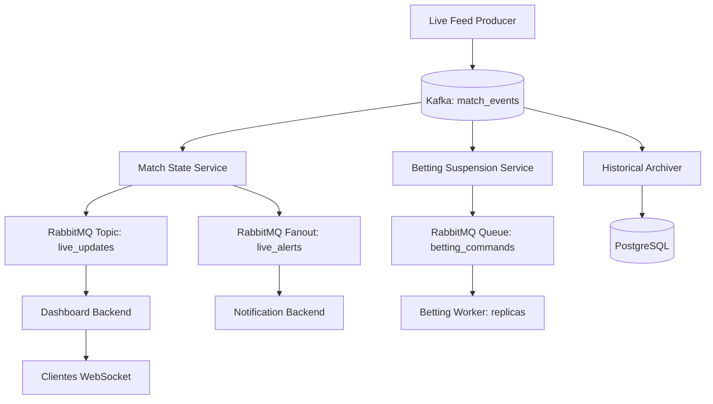

# VAR-Enabled: Plataforma de marcadores deportivos en vivo para una casa de apuestas multideporte

> **Proyecto académico / caso de estudio** · Programación Orientada a Objetos — Sexto B · Universidad Cooperativa de Colombia, Campus Pasto · Noviembre de 2026

**Grupo 4:** Michael David Lagos Rosero · Ronald Felipe Benavides Bastidas · Julio Bolaños Benavides · Michael Lagos (cuarto integrante).

> [!IMPORTANT]
> Este README describe **el caso de estudio, el diseño y los requisitos propuestos**. No constituye evidencia de que todos los microservicios, pruebas o integraciones estén implementados. En el alcance inicial, la suspensión de apuestas se **simula por comandos**; las cuentas, billeteras, depósitos, retiros, cuotas y liquidación real se plantean como una **ampliación de la plataforma**.

## Tabla de contenido

1. [Resumen](#1-resumen)
2. [Problema y justificación](#2-problema-y-justificación)
3. [Objetivos](#3-objetivos)
4. [Alcance y actores](#4-alcance-y-actores)
5. [Tecnologías](#5-tecnologías)
6. [Arquitectura y microservicios](#6-arquitectura-y-microservicios)
7. [Reglas de negocio](#7-reglas-de-negocio)
8. [Requisitos funcionales](#8-requisitos-funcionales)
9. [Requisitos no funcionales](#9-requisitos-no-funcionales)
10. [Requisitos de ampliación: apuestas deportivas](#10-requisitos-de-ampliación-apuestas-deportivas)
11. [Casos de uso](#11-casos-de-uso)
12. [Flujos por deporte](#12-flujos-por-deporte)
    - [Diagrama de secuencia: gol y revisión VAR](#124-diagrama-de-secuencia-del-proceso-var)
13. [Contratos de eventos y reglas de consistencia](#13-contratos-de-eventos-y-reglas-de-consistencia)
14. [Modelo orientado a objetos y SOLID](#14-modelo-orientado-a-objetos-y-solid)
    - [Diagrama de clases UML](#143-diagrama-de-clases-uml)
    - [Contexto del modelo de dominio](#144-contexto-del-modelo-de-dominio)
15. [Persistencia y diagrama entidad-relación](#15-persistencia-y-diagrama-entidad-relación)
16. [Pruebas y criterios de aceptación](#16-pruebas-y-criterios-de-aceptación)
17. [Despliegue propuesto](#17-despliegue-propuesto)
18. [Riesgos, limitaciones y mejoras futuras](#18-riesgos-limitaciones-y-mejoras-futuras)
19. [Entregables y evidencias](#19-entregables-y-evidencias)

## 1. Resumen

Se propone una plataforma distribuida que recibe eventos de **fútbol, baloncesto y voleibol**, actualiza los marcadores de los partidos en tiempo real, notifica cambios y **suspende o reanuda mercados de apuestas** durante jugadas críticas y revisiones por video. La solución conserva los eventos originales y registra las correcciones como nuevos eventos, lo que facilita reconstruir el historial y auditar decisiones.

La situación principal es un gol que se anuncia y luego se **anula por VAR**. El sistema debe mostrar primero el marcador provisional, suspender los mercados afectados, procesar la revisión y actualizar el marcador corregido sin borrar la evidencia histórica.

**VAR-Enabled** es el nombre del caso de estudio: en fútbol se usa VAR; en baloncesto se considera *Instant Replay* y en voleibol *Video Challenge*.

## 2. Problema y justificación

Una casa de apuestas deportivas depende de información confiable. Los eventos pueden llegar con retraso, duplicarse o corregirse después de una revisión arbitral. Si el marcador y los mercados no se sincronizan, la plataforma podría presentar datos contradictorios o permitir apuestas durante una situación de incertidumbre.

**Pregunta de estudio:** ¿Cómo construir una solución distribuida capaz de recibir, ordenar, validar y corregir eventos deportivos, manteniendo marcadores consistentes, alertas oportunas y mercados de apuestas en estados seguros?

**Riesgos que se busca mitigar:** marcadores equivocados, correcciones no propagadas, aperturas prematuras de mercados, mensajes duplicados, pérdida de trazabilidad y fallos en los consumidores.

## 3. Objetivos

**Objetivo general.** Diseñar y prototipar una arquitectura basada en eventos para gestionar marcadores deportivos y controlar la suspensión de apuestas durante revisiones por video.

**Objetivos específicos:**

- Publicar eventos inmutables en Kafka con `match_id` como clave.
- Construir marcadores mediante un consumidor con estado y lógica específica por deporte.
- Propagar marcadores y alertas por RabbitMQ y WebSocket.
- Enviar comandos idempotentes de suspensión/reanudación de mercados.
- Guardar eventos y revisiones en PostgreSQL para auditoría.
- Implementar diseño orientado a objetos con encapsulamiento, `record`, puertos e interfaces.
- Proponer pruebas automatizadas y despliegue con límites de CPU y memoria.

## 4. Alcance y actores

### 4.1 Alcance inicial del caso de estudio

**Incluye (propuesto):** simulación de eventos deportivos, marcador por deporte, anulaciones/revisiones, actualización en tiempo real, alertas, comandos simulados de suspensión, auditoría, pruebas y contenedores Docker.

**No incluye en el prototipo base:** cobros de dinero real, creación de apuestas liquidadas, gestión bancaria, definición comercial de cuotas, cartera de usuarios ni conexión con fuentes deportivas oficiales. Estos componentes se especifican aparte para evitar prometer funcionalidades inexistentes.

### 4.2 Actores

| Actor | Responsabilidad |
|---|---|
| Espectador / apostador | Consultar marcadores, avisos y estado de mercados; en una fase posterior, realizar apuestas. |
| Operador deportivo | Supervisar eventos, revisiones y estados de partido. |
| Administrador | Configurar deportes, mercados, permisos y monitoreo. |
| Productor de eventos | Emitir anotaciones, revisiones, anulaciones y finalizaciones. |
| Motor de marcador | Reconstruir el resultado y publicar actualizaciones. |
| Servicio de mercados | Suspender o autorizar la reanudación según las condiciones vigentes. |
| Servicio de auditoría | Conservar eventos y decisiones para consultas posteriores. |

## 5. Tecnologías

| Tecnología | Función en el proyecto |
|---|---|
| **Java 17 + Spring Boot** | Desarrollo de los microservicios y la lógica de dominio. |
| **Apache Kafka** | Registro ordenado y durable de eventos por partido (`match_events`). |
| **RabbitMQ** | Distribución de actualizaciones, alertas y comandos. |
| **WebSocket** | Envío de cambios de marcador al dashboard. |
| **PostgreSQL + JPA/Hibernate** | Persistencia y auditoría. |
| **JUnit 5 + Mockito** | Pruebas de dominio y servicios. |
| **Maven** | Compilación y gestión de dependencias en un monorepo multimódulo. |
| **Docker + Docker Compose** | Contenerización, redes, volúmenes y límites de recursos. |

> El documento fuente propone Kafka con ZooKeeper. La configuración concreta debe fijarse según la versión escogida; versiones actuales de Kafka pueden utilizar modo KRaft. No se debe mezclar una configuración ZooKeeper con una imagen configurada únicamente para KRaft.

## 6. Arquitectura y microservicios



| Componente | Entrada | Función / salida |
|---|---|---|
| `live-feed-producer` | Escenarios simulados | Publica eventos en Kafka con `match_id` como clave. |
| `match-state-service` | `match_events` | Aplica anotaciones o reversiones, mantiene estado y emite actualizaciones y alertas. |
| `dashboard-backend` | `live_updates` | Publica marcadores y estado de mercados por WebSocket. |
| `notification-backend` | `live_alerts` | Genera avisos de anotación, revisión y corrección. |
| `betting-suspension-service` | `match_events` | Determina cuándo suspender o solicitar reanudación y publica comandos. |
| `betting-worker` | `betting_commands` | Ejecuta comandos simulados con idempotencia; admite varias réplicas. |
| `historical-archiver` | `match_events` | Persiste eventos y decisiones de revisión en PostgreSQL. |

**Responsabilidades de los canales:** Kafka guarda *qué ocurrió*; `live_updates` comunica el *estado actual*; `live_alerts` distribuye *avisos*; `betting_commands` transporta *acciones*; PostgreSQL soporta *consultas y auditoría*.

## 7. Reglas de negocio

### 7.1 Registro y gestión de usuarios (ampliación comercial)

| Código | Regla |
|---|---|
| RN-U01 | Solo podrán registrarse personas mayores de 18 años. |
| RN-U02 | Un documento de identidad solo podrá corresponder a una cuenta. |
| RN-U03 | Para apostar será necesario iniciar sesión y contar con una cuenta habilitada. |
| RN-U04 | Los usuarios bloqueados o autoexcluidos no podrán realizar apuestas. |
| RN-U05 | Se deberá verificar la identidad antes de autorizar retiros, cuando aplique. |

### 7.2 Apuestas deportivas (ampliación comercial)

| Código | Regla |
|---|---|
| RN-A01 | Ninguna apuesta podrá superar el saldo disponible del usuario. |
| RN-A02 | El valor apostado deberá ser positivo y cumplir límites vigentes. |
| RN-A03 | Una apuesta deberá incluir al menos una selección de un mercado habilitado. |
| RN-A04 | Solo una apuesta confirmada podrá descontar saldo. |
| RN-A05 | Una apuesta confirmada no podrá ser editada unilateralmente. |
| RN-A06 | Toda apuesta conservará el valor, cuota, mercado, usuario y fecha de aceptación. |
| RN-A07 | Un mercado suspendido o cerrado no deberá aceptar nuevas apuestas. |

### 7.3 Partidos, eventos y marcadores (núcleo)

| Código | Regla |
|---|---|
| RN-M01 | Cada evento debe corresponder a un partido identificable. |
| RN-M02 | Cada evento debe tener un `event_id` único y marca temporal. |
| RN-M03 | La puntuación cambia según las reglas del deporte. |
| RN-M04 | Ninguna reversión puede generar marcadores negativos. |
| RN-M05 | Una anulación debe referenciar un evento válido del mismo partido. |
| RN-M06 | Una misma anotación no puede anularse dos veces. |
| RN-M07 | Un evento repetido no debe aplicarse nuevamente. |
| RN-M08 | El sistema debe preservar el orden lógico de eventos por partido. |

### 7.4 Revisiones por video y estados de mercados (núcleo)

| Código | Regla |
|---|---|
| RN-V01 | Los eventos críticos definidos por deporte suspenden los mercados afectados. |
| RN-V02 | Durante una revisión activa, los mercados afectados permanecen suspendidos. |
| RN-V03 | Una anulación debe corregir el marcador y generar aviso de rectificación. |
| RN-V04 | Anular una jugada no basta para reabrir automáticamente un mercado. |
| RN-V05 | Comandos repetidos de suspensión/reanudación no pueden duplicar efectos. |
| RN-V06 | Un mercado finalizado no podrá reabrirse por un comando tardío. |
| RN-V07 | Para reanudar se debe confirmar la continuidad, cerrar la revisión y descartar otros bloqueos. |

### 7.5 Cuotas, premios y pagos (ampliación comercial)

| Código | Regla |
|---|---|
| RN-C01 | Cada selección apostable tendrá una cuota vigente. |
| RN-C02 | Si la cuota cambia antes de confirmar, el usuario deberá aceptar la nueva cuota. |
| RN-C03 | El premio potencial simple se calcula como monto × cuota decimal aceptada. |
| RN-C04 | La liquidación se realiza con resultados validados y reglas del mercado. |
| RN-C05 | Una apuesta anulada tendrá tratamiento de devolución según sus condiciones. |
| RN-C06 | Un premio no podrá acreditarse dos veces. |
| RN-C07 | Un retiro no podrá superar el saldo disponible. |

### 7.6 Seguridad, alertas y auditoría (núcleo y ampliación)

| Código | Regla |
|---|---|
| RN-S01 | Las correcciones se registran como eventos nuevos, sin borrar el historial original. |
| RN-S02 | Cada actualización de marcador lleva versión para descartar estados obsoletos. |
| RN-S03 | Cada alerta identifica el partido y el evento de origen. |
| RN-S04 | Un partido solo se cierra con resultado consolidado. |
| RN-S05 | Los fallos de integración deben quedar registrados y admitir reproceso controlado. |
| RN-S06 | Cada depósito, retiro y premio debe tener identificador y registro de auditoría. |
| RN-S07 | El usuario debe poder activar mecanismos de juego responsable y autoexclusión. |

## 8. Requisitos funcionales

### 8.1 Eventos y validaciones

| Código | El sistema deberá... |
|---|---|
| RF-01 | Recibir eventos con `match_id`, `sport`, `event_id` y `event_type`. |
| RF-02 | Validar campos, participantes, deporte y valores de puntuación. |
| RF-03 | Publicar eventos con `match_id` como clave en Kafka. |
| RF-04 | Detectar y evitar el procesamiento doble de eventos duplicados. |
| RF-05 | Registrar y aislar eventos inválidos para análisis. |

### 8.2 Marcadores, revisiones y comunicación

| Código | El sistema deberá... |
|---|---|
| RF-06 | Calcular el marcador según el deporte. |
| RF-07 | Aplicar anulaciones vinculadas al evento original. |
| RF-08 | Reconstruir el marcador desde eventos persistidos después de reinicios. |
| RF-09 | Publicar marcador completo, versión y estado por RabbitMQ. |
| RF-10 | Actualizar el dashboard con WebSocket. |
| RF-11 | Emitir alertas de anotaciones, revisiones, correcciones y finalización. |

### 8.3 Mercados de apuestas y auditoría

| Código | El sistema deberá... |
|---|---|
| RF-12 | Detectar los eventos que suspenden apuestas según el deporte. |
| RF-13 | Emitir `SUSPEND_BETS` y `RESUME_BETS` a RabbitMQ. |
| RF-14 | Garantizar que procesar repetidamente un comando no duplique su efecto. |
| RF-15 | Mostrar estados del mercado en el dashboard. |
| RF-16 | Guardar eventos, revisiones y resultado final en PostgreSQL. |
| RF-17 | Permitir consultar la cronología de revisiones de un partido. |
| RF-18 | Reprocesar mensajes fallidos con una estrategia de reintento controlada. |

## 9. Requisitos no funcionales

> **Metas propuestas para el proyecto académico**, sujetas a validación mediante pruebas de rendimiento. No se presentan como cifras ya alcanzadas.

| Código | Categoría | Criterio verificable |
|---|---|---|
| RNF-01 | Rendimiento | Propagar el 95 % de actualizaciones válidas al dashboard en ≤ 2 segundos dentro del entorno de prueba. |
| RNF-02 | Rendimiento | Procesar ≥ 100 eventos/segundo en un escenario controlado. |
| RNF-03 | Consistencia | No producir marcadores negativos ni aplicar anulaciones duplicadas. |
| RNF-04 | Confiabilidad | Reconstruir el marcador tras reinicio desde los eventos almacenados. |
| RNF-05 | Idempotencia | Repetir el mismo evento o comando no altera dos veces su resultado. |
| RNF-06 | Disponibilidad | Objetivo de servicio del 99,5 % mensual para una futura operación gestionada; no comprometido por el prototipo local. |
| RNF-07 | Seguridad | Proteger APIs y canales externos con TLS y controles de acceso apropiados. |
| RNF-08 | Observabilidad | Registrar `event_id`, `match_id`, marcas temporales y errores de procesamiento. |
| RNF-09 | Mantenibilidad | Mantener lógica de negocio separada de Kafka, RabbitMQ, JPA y WebSocket. |
| RNF-10 | Recursos | Definir límites de CPU y RAM en contenedores y parámetros acordes para JVM. |
| RNF-11 | Compatibilidad | Ofrecer una interfaz adaptable a computadora y móvil. |
| RNF-12 | Persistencia | Mantener los datos de PostgreSQL en volumen persistente entre reinicios de contenedores. |
| RNF-13 | Pruebas | Automatizar pruebas del dominio y casos de fallo con JUnit 5 y Mockito. |
| RNF-14 | Robustez | Manejar reintentos y mensajes fallidos sin corromper el marcador ni el estado del mercado. |
| RNF-15 | Trazabilidad | Conservar referencia entre corrección, evento original y decisión de mercado. |

## 10. Requisitos de ampliación: apuestas deportivas

Estos requisitos complementan los anteriores para convertir el prototipo de marcadores y suspensión de mercados en una **plataforma comercial de apuestas**. No forman parte de los siete microservicios originales y necesitan módulos adicionales.

### 10.1 Gestión de usuarios

| Código | El sistema deberá... |
|---|---|
| RF-EXT-01 | Registrar usuarios y validar mayoría de edad. |
| RF-EXT-02 | Evitar registros duplicados por documento. |
| RF-EXT-03 | Permitir inicio y cierre de sesión. |
| RF-EXT-04 | Facilitar recuperación segura de contraseña. |
| RF-EXT-05 | Permitir consultar y modificar datos de contacto. |

### 10.2 Apuestas deportivas

| Código | El sistema deberá... |
|---|---|
| RF-EXT-06 | Mostrar mercados disponibles por deporte. |
| RF-EXT-07 | Permitir ingresar un monto de apuesta válido. |
| RF-EXT-08 | Verificar saldo antes de confirmar. |
| RF-EXT-09 | Admitir apuestas simples y combinadas, según mercados habilitados. |
| RF-EXT-10 | Presentar resumen de apuesta, cuota y premio potencial. |
| RF-EXT-11 | Guardar apuestas confirmadas con sus condiciones aceptadas. |
| RF-EXT-12 | Mostrar el historial y estado de apuestas de cada usuario. |

### 10.3 Eventos deportivos

| Código | El sistema deberá... |
|---|---|
| RF-EXT-13 | Organizar eventos por deporte y competición. |
| RF-EXT-14 | Mostrar participantes, fecha y hora. |
| RF-EXT-15 | Buscar partidos por equipo o competición. |
| RF-EXT-16 | Presentar los estados programado, en vivo, suspendido, cancelado y finalizado. |
| RF-EXT-17 | Impedir apuestas sobre mercados cerrados o suspendidos. |

### 10.4 Cuotas

| Código | El sistema deberá... |
|---|---|
| RF-EXT-18 | Mostrar cuotas de selecciones disponibles. |
| RF-EXT-19 | Recibir actualizaciones de cuotas de una fuente autorizada. |
| RF-EXT-20 | Solicitar aceptación cuando cambie la cuota antes de confirmar. |
| RF-EXT-21 | Mostrar cálculo de premio potencial antes de la confirmación. |

### 10.5 Resultados y premios

| Código | El sistema deberá... |
|---|---|
| RF-EXT-22 | Registrar resultados validados para liquidación. |
| RF-EXT-23 | Determinar apuestas ganadas, perdidas y anuladas. |
| RF-EXT-24 | Calcular premios según mercado y cuota aceptada. |
| RF-EXT-25 | Acreditar premios sin pagos duplicados. |
| RF-EXT-26 | Mostrar el estado de liquidación de la apuesta. |

### 10.6 Pagos

| Código | El sistema deberá... |
|---|---|
| RF-EXT-27 | Aceptar depósitos mediante medios habilitados. |
| RF-EXT-28 | Permitir solicitar retiros. |
| RF-EXT-29 | Verificar el saldo disponible antes del retiro. |
| RF-EXT-30 | Actualizar el saldo tras movimientos confirmados. |
| RF-EXT-31 | Presentar historial de depósitos, retiros, apuestas y premios. |

### 10.7 Administración y protección

| Código | El sistema deberá... |
|---|---|
| RF-EXT-32 | Permitir a administradores configurar eventos y mercados autorizados. |
| RF-EXT-33 | Gestionar bloqueos de cuentas conforme a permisos. |
| RF-EXT-34 | Permitir activar autoexclusión. |
| RF-EXT-35 | Auditar operaciones administrativas relevantes. |

**Metas adicionales de calidad para una eventual plataforma comercial:** autenticación robusta, gestión de secretos, protección de datos personales, comprobación de idempotencia financiera, copias de seguridad, monitoreo antifraude, accesibilidad y políticas de retención documentadas. Estas capacidades deben verificarse según los requisitos legales y operativos vigentes antes de cualquier operación real.

## 11. Casos de uso

| Código | Actor principal | Caso de uso | Resultado esperado |
|---|---|---|---|
| CU-01 | Productor | Registrar anotación | El evento se valida, publica y afecta el marcador. |
| CU-02 | Motor de marcador | Actualizar marcador en vivo | El dashboard recibe el nuevo estado. |
| CU-03 | Operador / flujo de eventos | Anular gol por VAR | Se conserva el evento original y se publica la corrección. |
| CU-04 | Servicio de mercados | Suspender mercados | Se bloquean nuevas apuestas en los mercados afectados. |
| CU-05 | Servicio de mercados | Reanudar mercados | Solo se permite si no existen suspensiones activas. |
| CU-06 | Auditor / operador | Consultar revisiones | Se visualiza la cronología de hechos y decisiones. |
| CU-07 | Operador / sistema | Corregir canasta | Se modifica el marcador de 3 a 2 puntos. |
| CU-08 | Operador / sistema | Reabrir set de voleibol | Se revierte un punto y se recalcula el set. |

### CU-03: Anular gol por VAR — flujo principal

**Precondiciones:** partido activo, gol registrado con `event_id`, revisión habilitada, mercados afectados identificados.

1. El productor publica `GOAL` y el marcador refleja el gol.
2. El servicio de mercados emite la suspensión y el dashboard identifica el estado provisional.
3. Llega `VAR_CHECK` y se mantiene la suspensión.
4. La revisión determina que el gol no es válido.
5. Se publica `GOAL_ANNULLED` con `annuls_event_id` apuntando al gol original.
6. El agregado del partido verifica la referencia y revierte exactamente una vez.
7. El sistema difunde el marcador corregido con una nueva versión y envía una alerta.
8. La auditoría conserva el gol original, su anulación y sus marcas temporales.
9. El mercado **solo se reabre** cuando se recibe confirmación de continuidad y se valida la ausencia de bloqueos.

**Flujos alternativos:** evento inexistente → error controlado; anulación repetida → se ignora o rechaza sin modificar marcador; reanudación prematura → se mantiene suspensión; evento fuera de orden → se procesa conforme a la política de reconciliación.

**Postcondición:** marcador consistente, historial auditable y mercados con estado seguro.

## 12. Flujos por deporte

### 12.1 Fútbol: gol anulado

| Paso | Evento | Marcador | Mercado |
|---|---|---|---|
| 1 | `MATCH_STARTED` | 0-0 | Abierto (si se autoriza). |
| 2 | `GOAL` del local | 1-0 provisional | Suspendido. |
| 3 | `VAR_CHECK` | 1-0 provisional | Suspendido. |
| 4 | `GOAL_ANNULLED` | 0-0 | Sigue suspendido. |
| 5 | `MATCH_CONTINUES` + validaciones | 0-0 | Puede reabrirse. |

### 12.2 Baloncesto: triple corregido a doble

1. Marcador inicial: **80-78**.
2. `BASKET(points=3)` → **83-78**.
3. `REVIEW_CHECK` → se suspenden mercados afectados.
4. `BASKET_ANNULLED` → **80-78**.
5. `BASKET(points=2)` → **82-78**.
6. `MATCH_CONTINUES` y verificación → posible reanudación.

### 12.3 Voleibol: punto anulado y set reabierto

1. El local gana un punto y el set llega a **25-23**.
2. Se anuncia `SET_WON`, pero el rival solicita `CHALLENGE_REQUESTED`.
3. El punto local se anula; el set vuelve a **24-23**.
4. El punto se asigna al visitante y queda **24-24**.
5. Se recalcula el estado del set y solo entonces se habilita la continuidad.

### 12.4 Diagrama de secuencia del proceso VAR

La siguiente figura representa el **flujo temporal de eventos y mensajes** entre el productor, Kafka, el servicio de estado ("Cerebro"), RabbitMQ, la interfaz web y el subsistema de apuestas. Técnicamente es un **diagrama de secuencia UML**, no un diagrama de flujo convencional.


**Explicación del diagrama:**

1. **Registro del gol:** el productor envía `GOAL (evt_g123)` a Kafka.
2. **Actualización del marcador:** el servicio de estado procesa el evento y muestra el marcador provisional `1-0`.
3. **Notificación:** RabbitMQ recibe la actualización y la interfaz web muestra `1-0`.
4. **Protección de apuestas:** el subsistema de apuestas recibe la orden de suspensión del mercado afectado.
5. **Revisión VAR:** se examina la jugada y posteriormente llega `GOAL_ANNULLED`, referenciando `evt_g123`.
6. **Corrección:** el servicio de estado revierte el gol válido, reconstruye el resultado `0-0` y publica una alerta.
7. **Reanudación segura:** **ajuste recomendado al diagrama original**: el mercado debe permanecer suspendido hasta recibir una confirmación explícita de final de revisión (`MATCH_CONTINUES`) y verificar que no haya otra causal de suspensión. Un evento `GOAL_ANNULLED`, por sí solo, no autoriza reabrir apuestas.

> **Nota técnica:** la figura resume el flujo con seis participantes. En la implementación descrita en este README, el microservicio `betting_suspension_service` y los `betting_worker` son responsables de generar y ejecutar los comandos de suspensión y reanudación. Kafka mantiene el historial de eventos y RabbitMQ distribuye actualizaciones, alertas y comandos.

## 13. Contratos de eventos y reglas de consistencia

### 13.1 Ejemplos JSON

**Gol:**

```json
{
  "event_id": "evt_g123",
  "match_id": "match_123",
  "sport": "FOOTBALL",
  "event_type": "GOAL",
  "team": "home",
  "timestamp": "2026-11-21T14:30:00-05:00"
}
```

**Anulación:**

```json
{
  "event_id": "evt_var124",
  "match_id": "match_123",
  "sport": "FOOTBALL",
  "event_type": "GOAL_ANNULLED",
  "annuls_event_id": "evt_g123",
  "timestamp": "2026-11-21T14:30:22-05:00"
}
```

**Actualización de marcador (propuesta):**

```json
{
  "match_id": "match_123",
  "sport": "FOOTBALL",
  "home": 0,
  "away": 0,
  "version": 3,
  "market_status": "SUSPENDED"
}
```

### 13.2 Enrutamiento en RabbitMQ

- **Kafka topic:** `match_events`, particionado por `match_id`.
- **Topic exchange:** `live_updates`, ejemplo de routing key `score.match_123`; suscripción `score.*`.
- **Fanout exchange:** `live_alerts`, alertas generales a consumidores conectados.
- **Work queue:** `betting_commands`, comandos distribuidos entre trabajadores.

### 13.3 Consistencia y seguridad de mercados

**Estados sugeridos:** `OPEN`, `SUSPENDED`, `CLOSED`, `SETTLED`.

**Política recomendada:** `OPEN -> SUSPENDED` por evento crítico; `SUSPENDED -> OPEN` solo tras resolución y autorización; `OPEN/SUSPENDED -> CLOSED` cuando termina la ventana de apuesta; `CLOSED -> SETTLED` después de validar el resultado. Las transiciones inválidas deben rechazarse.

Kafka garantiza el orden de los registros **dentro de una partición**, no un orden global entre todas. La clave `match_id` facilita el orden por partido si los eventos del mismo partido conservan esa clave y su particionado. Los consumidores aún deben controlar duplicados, reintentos y sucesos tardíos.

La publicación a RabbitMQ y los cambios persistentes pueden requerir patrones como *outbox*, confirmaciones de publicación e idempotencia para evitar divergencias ante fallos; son **mejoras recomendadas**, no implementaciones confirmadas.

## 14. Modelo orientado a objetos y SOLID

### 14.1 Propuesta de clases

| Elemento | Responsabilidad |
|---|---|
| `MatchScoreAggregate` | Clase abstracta que protege el estado del partido y define comportamiento común. |
| `FootballMatch` | Registrar y anular goles por VAR. |
| `BasketballMatch` | Registrar y corregir canastas de 1, 2 o 3 puntos. |
| `VolleyballMatch` | Registrar puntos, sets y reversiones por Video Challenge. |
| `MatchId`, `EventId`, `Score`, `AnnulmentRef` | Value Objects inmutables con validación temprana. |
| `MatchStateRepositoryPort` | Contrato abstracto para recuperar y guardar estado. |
| `ScoreBroadcastPort` | Publicar marcadores sin depender del broker concreto. |
| `LiveAlertPublisherPort` | Publicar avisos sin acoplarse a RabbitMQ. |
| `BettingCommandPublisherPort` | Emitir comandos de mercado a través de una abstracción. |

### 14.2 Principios SOLID

- **S — Responsabilidad única:** cada microservicio y clase cumple una función específica.
- **O — Abierto/cerrado:** se pueden añadir deportes extendiendo abstracciones, sin reescribir servicios centrales.
- **L — Sustitución de Liskov:** los agregados de diferentes deportes mantienen los contratos comunes.
- **I — Segregación de interfaces:** los puertos exponen las operaciones mínimas necesarias.
- **D — Inversión de dependencias:** la lógica de negocio depende de puertos, no directamente de Kafka, RabbitMQ o JPA.

**Invariantes del dominio:** identificadores no vacíos; marcadores no negativos; anotaciones válidas; una anulación por referencia; transición de mercado autorizada. Evitar setters públicos que permitan saltarse estas reglas.

### 14.3 Diagrama de clases UML

Esta figura muestra una **vista simplificada del modelo orientado a objetos** del proyecto. Aparecen el evento inmutable `Evento`, el servicio `PartidoService`, la interfaz `Notificador` y una clase abstracta `Partido` con tres especializaciones: `PartidoFutbol`, `PartidoBaloncesto` y `PartidoVoleibol`.


**Elementos principales y relaciones:**

| Elemento | Función en el diseño |
|---|---|
| `Evento` (`record`) | Transporta el identificador, partido, tipo, equipo, puntos y referencia al evento anulado. |
| `PartidoService` | Recibe y procesa eventos y coordina la actualización de cada partido. |
| `Notificador` (`interface`) | Define el contrato para emitir alertas sin acoplar el servicio a un canal concreto. |
| `Partido` (abstracta) | Define el comportamiento común `aplicarEvento(...)`. |
| `PartidoFutbol` | Gestiona goles y anulaciones por VAR. |
| `PartidoBaloncesto` | Gestiona canastas, valor de puntos y reversiones. |
| `PartidoVoleibol` | Gestiona puntos, sets y anulaciones por revisión. |
| `Gol`, `Canasta`, `Punto` | Representan anotaciones individuales vinculadas a su partido y con estado de anulación. |

**Relaciones:** `PartidoFutbol`, `PartidoBaloncesto` y `PartidoVoleibol` **heredan de** `Partido`; cada tipo de partido **contiene** sus anotaciones (composición); `PartidoService` **procesa** `Evento`, **actualiza** el partido correspondiente y **utiliza** la interfaz `Notificador`.

**Correspondencia con la arquitectura:** los nombres de esta imagen están en español y simplificados para su explicación académica. En el diseño técnico del README, `Partido` corresponde conceptualmente a `MatchScoreAggregate`, y sus especializaciones a `FootballMatch`, `BasketballMatch` y `VolleyballMatch`. No son dos jerarquías que deban implementarse simultáneamente.

### 14.4 Contexto del modelo de dominio

**Imagen de referencia:** [Ver diagrama de contexto del modelo de dominio (diagrama de clases UML)](docs/images/diagrama-clases-uml.png).

La imagen suministrada para esta sección es **la misma** que aparece en el apartado 14.3. Se conserva una sola copia para evitar archivos duplicados. Aunque sirve para explicar el **contexto del modelo de dominio**, su notación corresponde a un **diagrama de clases UML**, no a un diagrama de contexto del sistema tradicional.

**Contexto que representa:**

1. **Entrada de información:** el `record Evento` transporta los datos de goles, canastas, puntos y anulaciones.
2. **Procesamiento central:** `PartidoService` recibe el evento y delega su aplicación al partido correspondiente.
3. **Especialización por deporte:** la clase abstracta `Partido` permite modelar comportamientos compartidos; fútbol, baloncesto y voleibol aplican sus reglas específicas.
4. **Registro de anotaciones:** `Gol`, `Canasta` y `Punto` conservan la referencia del evento y si la anotación fue anulada.
5. **Comunicación:** la interfaz `Notificador` representa el contrato utilizado para comunicar cambios del encuentro.

**Relación con las apuestas deportivas:** el modelo explica el cálculo y la corrección de marcadores que sirven como entrada al servicio de suspensión de mercados. Los saldos, cuotas y transacciones de apuestas no están representados en esta imagen: pertenecen a otros componentes del sistema o a ampliaciones futuras.

## 15. Persistencia y diagrama entidad-relación

### 15.1. Diagrama entidad-relación (DER)

El siguiente diagrama representa el modelo relacional propuesto para la base de datos **PostgreSQL** del microservicio `historical_archiver`. Organiza los equipos, partidos, acontecimientos, revisiones VAR y cambios de marcador que permiten auditar el desarrollo de un encuentro.


> **Alcance del esquema:** la imagen presenta campos como `goles_local_final` y `goles_visitante_final`, específicos de fútbol. Para baloncesto y voleibol será necesario ampliar el modelo con puntuaciones, periodos y sets; el diagrama no pretende cubrir por completo esos deportes.

### 15.2. Entidades y atributos principales

| Entidad | Identificador principal | Función y atributos destacados |
|---|---|---|
| `EQUIPO` | `id_equipo` | Catálogo de equipos, con `nombre` y `codigo`. |
| `PARTIDO` | `match_id` | Partido, equipos local y visitante, `inicio`, `estado`, goles finales. |
| `EVENTO_PARTIDO` | `event_id` | Evento, partido, `event_type`, `team`, minuto, marcas de tiempo, `kafka_partition`, `kafka_offset` y referencia opcional `annuls_event_id`. |
| `INTERVENCION_VAR` | `id_intervencion` | Evento revisado, evento de resolución, decisión, inicio y fin de revisión. |
| `HISTORIAL_MARCADOR` | `id_registro` | Marcador local y visitante tras el evento, motivo y momento de registro. |

### 15.3. Relaciones y claves foráneas

| Relación | Cardinalidad / significado |
|---|---|
| `EQUIPO` → `PARTIDO` (local) | Un equipo puede jugar muchos partidos como local; cada partido referencia un equipo local. |
| `EQUIPO` → `PARTIDO` (visitante) | Un equipo puede jugar muchos partidos como visitante; cada partido referencia un equipo visitante. |
| `PARTIDO` → `EVENTO_PARTIDO` | Un partido registra cero o muchos eventos; cada evento corresponde a un partido. |
| `EVENTO_PARTIDO` → `EVENTO_PARTIDO` | `annuls_event_id` referencia, cuando aplique, el evento original que se corrige. |
| `EVENTO_PARTIDO` → `INTERVENCION_VAR` | `evento_revisado_id` y `evento_resolucion_id` relacionan la intervención con sus eventos. |
| `EVENTO_PARTIDO` → `HISTORIAL_MARCADOR` | Cada registro de marcador referencia el evento que originó la actualización. |

### 15.4. Reglas de integridad de los datos

- Cada clave primaria debe ser única y no nula.
- `equipo_local_id` y `equipo_visitante_id` deben referenciar equipos válidos y ser distintos.
- `match_id` de `EVENTO_PARTIDO` debe corresponder a un partido existente.
- `annuls_event_id`, cuando no sea nulo, debe corresponder a un evento previamente registrado y del mismo partido.
- Una anulación no puede aplicarse dos veces sobre el mismo evento original.
- Las puntuaciones deben ser no negativas; el historial no se sobrescribe al realizar correcciones.
- Los campos `kafka_partition` y `kafka_offset` permiten identificar la posición de ingesta para trazabilidad y deduplicación, junto con el identificador del evento.
- Las relaciones de VAR deben apuntar a eventos coherentes con el encuentro revisado.

### 15.5. Relación con los microservicios

El `historical_archiver` consume el flujo de `match_events` en Kafka, transforma los mensajes en registros relacionales y conserva el historial. El `match_state_service` calcula el marcador vigente; PostgreSQL mantiene la evidencia histórica necesaria para explicar una corrección posterior. Son responsabilidades diferentes.

### 15.6. Tablas de ampliación propuestas

El documento original también utiliza nombres lógicos de persistencia que pueden implementarse como vistas, tablas adicionales o equivalencias de las entidades del DER:

| Tabla lógica | Contenido / relación con el DER |
|---|---|
| `match_event_log` | Equivalente funcional a `EVENTO_PARTIDO`. |
| `video_review_audit` | Equivalente funcional a `INTERVENCION_VAR`. |
| `final_score` | Resultado validado, que puede obtenerse de `PARTIDO` o almacenarse por separado. |
| `market_command_audit` *(propuesta futura)* | Historial de comandos de suspensión/reanudación e idempotencia. |
| `consumer_failure_log` *(propuesta futura)* | Fallos, reintentos y diagnósticos de consumidores. |

> Los nombres de tablas de la propuesta inicial y de la nueva imagen **no coinciden exactamente**. Al implementar la base de datos se debe escoger una nomenclatura única y actualizar las entidades JPA y las migraciones correspondientes. Se recomienda mantener separadas las entidades JPA del modelo de dominio y usar mapeadores.

## 16. Pruebas y criterios de aceptación

### 16.1 Matriz de pruebas propuestas

| ID | Escenario | Resultado esperado |
|---|---|---|
| PR-01 | Registrar gol válido | Marcador +1 para el equipo correcto. |
| PR-02 | Anular gol existente | El marcador vuelve al valor anterior. |
| PR-03 | Anular evento inexistente | Excepción de dominio controlada. |
| PR-04 | Anular dos veces el mismo gol | No se descuenta dos veces. |
| PR-05 | Reenviar evento ya procesado | El estado permanece igual. |
| PR-06 | Corregir triple a doble | El marcador se ajusta en un punto neto. |
| PR-07 | Anular punto final de set | El set se reabre y recalcula. |
| PR-08 | Suspender mercado por revisión | Mercado deja de aceptar apuestas. |
| PR-09 | Reanudar mientras hay bloqueo | El mercado continúa suspendido. |
| PR-10 | Repetir `SUSPEND_BETS` | Una sola suspensión efectiva. |
| PR-11 | Reiniciar consumidor y reconstruir | Marcador coincide con el historial. |
| PR-12 | Recibir marcador antiguo en dashboard | Se descarta por versión inferior. |
| PR-13 | Fallo temporal del broker | Se reintenta sin producir duplicaciones de efecto. |
| PR-14 | Terminar partido | El resultado final queda consolidado y auditado. |

### 16.2 Estrategia de pruebas

- **Unitarias de dominio:** JUnit 5; pruebas AAA (*Arrange–Act–Assert*) sin base de datos ni brokers.
- **Servicios:** Mockito, `@Mock`, `@InjectMocks` y `verify` para interacciones controladas.
- **Integración:** Kafka, RabbitMQ y PostgreSQL con contenedores de prueba, cuando se implementen.
- **Extremo a extremo:** publicar `GOAL` → suspender → `GOAL_ANNULLED` → actualizar dashboard → resolver revisión → reanudar → auditar.
- **Carga:** medir eventos por segundo, latencia p95 y comportamiento al aumentar consumidores.

**Criterio mínimo de aceptación:** los escenarios críticos del fútbol se reproducen, la anulación correcta restaura el marcador, no existen reversiones dobles, las alertas y comandos se emiten, y el historial permite reconstruir qué ocurrió.

## 17. Despliegue propuesto

### 17.1 Estructura esperada del repositorio

```text
VAR-Enabled/
├── README.md
├── pom.xml
├── docker-compose.yml
├── common-domain/
├── live-feed-producer/
├── match-state-service/
├── dashboard-backend/
├── notification-backend/
├── betting-suspension-service/
├── betting-worker/
├── historical-archiver/
└── docs/
```

> La estructura anterior es la **organización propuesta**. Confirma que los nombres de carpetas y archivos coincidan con el repositorio real antes de ejecutar comandos.

### 17.2 Guía de ejecución prevista

**Requisitos:** JDK 17, Maven, Docker y Docker Compose instalados; puertos disponibles y variables de entorno configuradas.

```bash
# Desde la raíz del repositorio, cuando exista el proyecto:
mvn clean test
mvn clean package -DskipTests
docker compose up --build -d
docker compose ps
docker compose logs -f
```

Para detener los servicios:

```bash
docker compose down
```

**Nota:** estos son comandos de referencia; su ejecución correcta depende de que existan los módulos, los `pom.xml`, los Dockerfile y el archivo Compose con servicios y configuraciones válidas. No se ha verificado la ejecución del repositorio.

### 17.3 Configuración recomendada

- Dockerfiles multietapa (Maven/JDK para compilar, JRE para ejecución).
- Contenedores ejecutados con usuario sin privilegios.
- Límites explícitos de CPU y memoria, y configuración de la JVM acorde al entorno.
- Volumen persistente de PostgreSQL.
- *Health checks* y política de reinicio razonable.
- Variables sensibles en entorno seguro; no subir contraseñas a GitHub.
- Réplicas de `betting-worker` para demostrar cola de trabajo y reparto de mensajes.

## 18. Riesgos, limitaciones y mejoras futuras

| Riesgo o límite | Mitigación o ampliación sugerida |
|---|---|
| Desfase entre evento y suspensión real | Rechazo de apuestas con verificación del estado de mercado al confirmar. |
| Eventos duplicados o fuera de orden | Idempotencia, claves de evento y versionamiento por partido. |
| Pérdida de mensajes al reiniciar | Persistencia, confirmaciones y reconstrucción desde historial. |
| Revisión concurrente y reapertura prematura | Registrar causas activas de suspensión y validar estado antes de reabrir. |
| Fuente de datos simulada | Integrar proveedor deportivo autorizado en una fase posterior. |
| Mercado sin motor de cuotas ni billetera | Construir servicios adicionales para cuentas, cuotas, apuestas y pagos. |
| Despliegue local sin alta disponibilidad | Definir monitoreo, replicación y métricas al evolucionar a producción. |
| Información sensible de usuarios | Diseñar controles de acceso, cifrado y políticas de protección de datos. |

**Posibles mejoras futuras:** autenticación, perfiles, gestión de saldo, mercados en vivo, historial de apuestas, motor de cuotas, promociones bajo reglas definidas, panel administrativo, reportes, observabilidad y métricas de latencia.

**Aspectos legales:** una eventual operación real de apuestas en Colombia requiere revisar los requisitos vigentes de la autoridad competente, los controles de participación, prevención del fraude, protección de datos y juego responsable. Este caso de estudio **no representa una plataforma autorizada para operar con dinero real**.

## 19. Entregables y evidencias

### 19.1 Lista de verificación

- [ ] Crear monorepo Maven y siete microservicios.
- [ ] Configurar Kafka y el topic `match_events` con clave `match_id`.
- [ ] Configurar RabbitMQ (`live_updates`, `live_alerts`, `betting_commands`).
- [ ] Configurar PostgreSQL con volumen persistente.
- [ ] Implementar marcadores para fútbol, baloncesto y voleibol.
- [ ] Implementar anulación por VAR y control de mercados.
- [ ] Mostrar actualizaciones en dashboard/WebSocket.
- [ ] Añadir pruebas unitarias y de integración.
- [ ] Documentar contratos JSON y transiciones de estados.
- [ ] Agregar Dockerfiles y límites de recursos.
- [ ] Grabar o capturar la ejecución del escenario principal.
- [ ] Registrar pruebas, incidencias y resultados observados.

### 19.2 Evidencias útiles para GitHub

Los diagramas proporcionados se incluyen en `docs/images/` y se enlazan mediante rutas relativas, para que GitHub los muestre automáticamente. Guardar en `docs/` capturas de los contenedores activos, logs de Kafka/RabbitMQ, eventos publicados, cambios de marcador, revisión VAR, estado suspendido/reanudado, registros PostgreSQL y resultados de pruebas. Incluir capturas reales solo cuando estén disponibles; evitar imágenes que simulen resultados como si hubieran sido medidos.

### 19.3 Conclusión

El proyecto permite estudiar la combinación de **arquitectura dirigida por eventos, sistemas distribuidos, POO, SOLID, mensajería y persistencia** mediante un problema realista: una jugada inicialmente validada puede corregirse después. Separar el **historial de hechos**, el **estado actual** y las **acciones sobre mercados** permite razonar mejor sobre consistencia, recuperación y auditoría. El diseño constituye una base para un prototipo académico y futuras ampliaciones de apuestas deportivas.

---

**Documento de referencia:** *Caso de Estudio — Ejercicio 5: Plataforma de Marcadores Deportivos en Vivo (VAR-Enabled) para una Casa de Apuestas Multideporte* y su versión ampliada. Las reglas y requisitos comerciales se añadieron para incorporar el alcance solicitado de una plataforma de apuestas deportivas.
