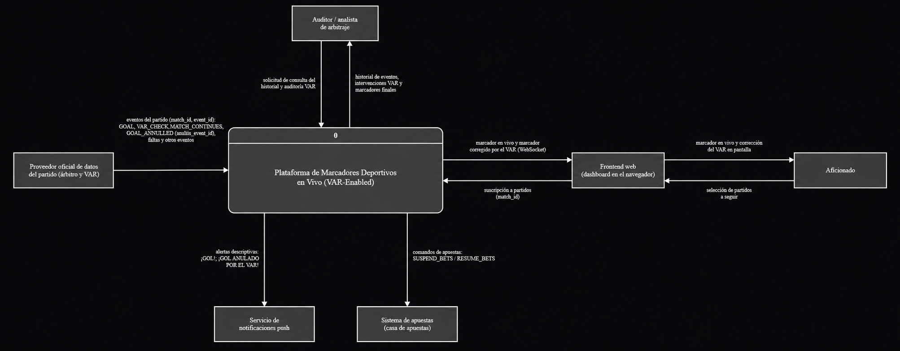
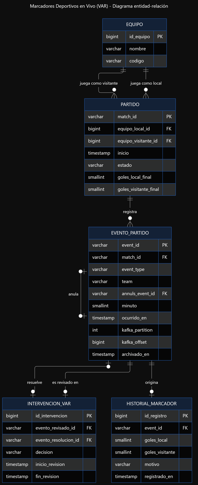
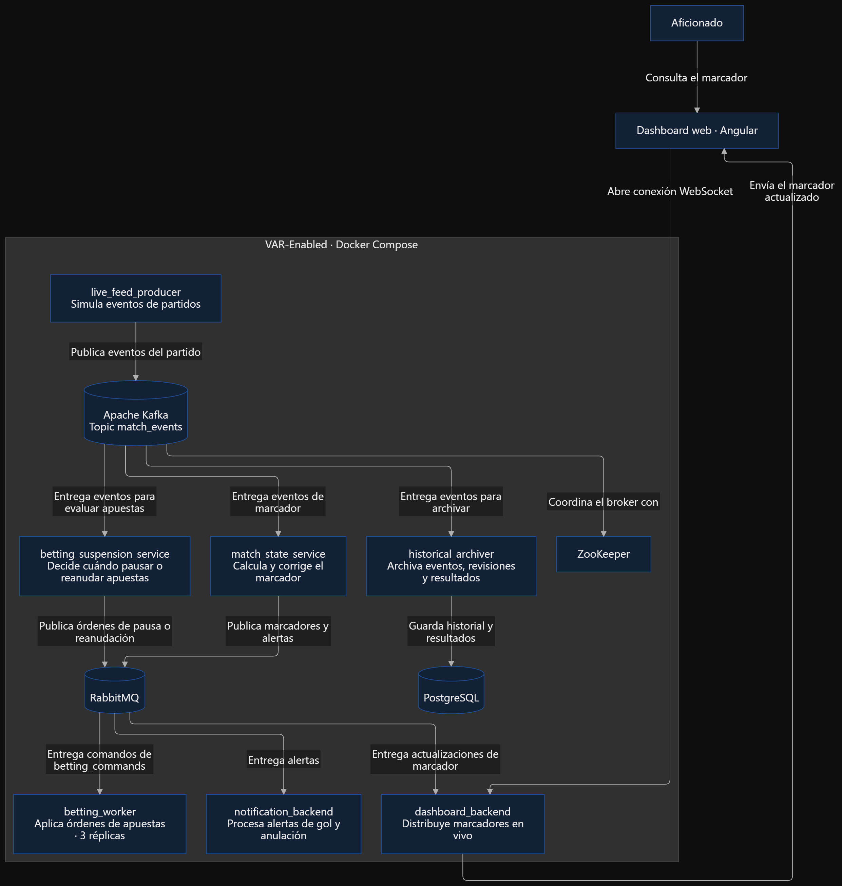

# VAR-Enabled | Marcadores deportivos en vivo

**Universidad Cooperativa de Colombia — Campus Pasto**  
**Programación Orientada a Objetos — Sexto B**  
**Integrantes:** Michael David Lagos Rosero, Ronald Felipe Benavides Bastidas y Julio Bolaños Benavides

## 1. Descripción

VAR-Enabled procesa resultados en vivo de fútbol, baloncesto y voleibol para una casa de apuestas deportivas. Cuando ocurre una jugada importante, actualiza el marcador, envía alertas y controla la suspensión de mercados.

Si se registra un gol y después el VAR lo anula, el sistema corrige el marcador y conserva ambos eventos para su consulta. El proyecto simula el control de apuestas; no maneja dinero real.

## 2. Tecnologías

| Tecnología | Uso |
|---|---|
| Java 17 y Spring Boot | Microservicios y lógica del sistema |
| Apache Kafka | Recepción y registro de eventos |
| RabbitMQ | Notificaciones y comandos |
| PostgreSQL | Historial y revisiones |
| WebSocket | Actualización de marcadores en la web |
| Maven, JUnit 5 y Mockito | Compilación y pruebas |
| Docker Compose | Ejecución de los servicios |

## 3. Arquitectura

| Servicio | Función |
|---|---|
| `live-feed-producer` | Genera eventos deportivos. |
| `match-state-service` | Actualiza y corrige marcadores. |
| `dashboard-backend` | Publica resultados por WebSocket. |
| `notification-backend` | Envía alertas. |
| `betting-suspension-service` | Define cuándo suspender o reanudar mercados. |
| `betting-worker` | Ejecuta los comandos de apuestas. |
| `historical-archiver` | Guarda los eventos y las revisiones. |

Kafka distribuye los eventos; RabbitMQ envía las alertas y órdenes; PostgreSQL conserva el historial.

## 4. Reglas de negocio

### 4.1. Partidos y marcadores

| Código | Regla |
|---|---|
| RN-01 | Cada partido y evento tendrá un identificador único. |
| RN-02 | Todo evento estará asociado a un partido y deporte. |
| RN-03 | El marcador se calculará según las reglas del deporte. |
| RN-04 | No se permitirán marcadores negativos. |
| RN-05 | Un evento duplicado no modificará el marcador más de una vez. |
| RN-06 | Los eventos del mismo partido se procesarán respetando su secuencia lógica. |

<<<<<<< HEAD
### 4.2. Revisión por video

| Código | Regla |
|---|---|
| RN-07 | Una anulación identificará el evento original mediante `annuls_event_id`. |
| RN-08 | Solo se podrá anular una anotación existente del mismo partido. |
| RN-09 | Una anotación no podrá anularse dos veces. |
| RN-10 | La anulación corregirá el marcador sin borrar el evento original. |
| RN-11 | Toda corrección generará una nueva actualización y su registro de auditoría. |

### 4.3. Mercados de apuestas

| Código | Regla |
|---|---|
| RN-12 | Los mercados afectados por una revisión o evento crítico deberán suspenderse. |
| RN-13 | Un mercado suspendido no podrá aceptar nuevas apuestas. |
| RN-14 | Un evento de anulación no reabrirá por sí solo un mercado. |
| RN-15 | Solo se reanudará un mercado cuando la revisión termine y no existan otros bloqueos. |
| RN-16 | Un mercado cerrado o finalizado no podrá reabrirse por un comando tardío. |
| RN-17 | Un comando repetido no producirá acciones duplicadas. |

### 4.4. Auditoría y notificaciones

| Código | Regla |
|---|---|
| RN-18 | Cada alerta identificará el partido y el evento correspondiente. |
| RN-19 | Las correcciones conservarán una referencia al evento que modifican. |
| RN-20 | Los errores de procesamiento deberán registrarse para su revisión. |

## 5. Requisitos funcionales

### 5.1. Eventos deportivos

| Código | Requisito |
|---|---|
| RF-01 | El sistema deberá recibir eventos con identificador, partido, deporte y tipo. |
| RF-02 | El sistema deberá validar los campos y valores de los eventos. |
| RF-03 | El sistema deberá publicar los eventos en Kafka utilizando `match_id` como clave. |
| RF-04 | El sistema deberá detectar eventos duplicados. |
| RF-05 | El sistema deberá registrar los eventos inválidos para análisis. |

### 5.2. Marcadores y revisiones

| Código | Requisito |
|---|---|
| RF-06 | El sistema deberá calcular marcadores de fútbol, baloncesto y voleibol. |
| RF-07 | El sistema deberá anular una anotación cuando reciba una corrección válida. |
| RF-08 | El sistema deberá reconstruir el marcador tras un reinicio a partir del historial. |
| RF-09 | El sistema deberá publicar las actualizaciones de marcador en RabbitMQ. |
| RF-10 | El sistema deberá enviar marcadores al dashboard mediante WebSocket. |
| RF-11 | El sistema deberá emitir notificaciones de anotaciones, revisiones y anulaciones. |

### 5.3. Suspensión y auditoría

| Código | Requisito |
|---|---|
| RF-12 | El sistema deberá detectar eventos que obligan a suspender mercados. |
| RF-13 | El sistema deberá enviar comandos `SUSPEND_BETS` y `RESUME_BETS`. |
| RF-14 | El sistema deberá ejecutar los comandos de forma idempotente. |
| RF-15 | El sistema deberá mostrar el estado del mercado en la interfaz. |
| RF-16 | El sistema deberá almacenar el historial en PostgreSQL. |
| RF-17 | El sistema deberá permitir consultar los eventos y revisiones de un partido. |
| RF-18 | El sistema deberá gestionar errores de mensajería mediante reintentos controlados. |

## 6. Requisitos no funcionales

Los valores numéricos son **objetivos de prueba**, no resultados verificados.

| Código | Categoría | Requisito |
|---|---|---|
| RNF-01 | Rendimiento | El 95 % de las actualizaciones deberá llegar al dashboard en un máximo de 2 segundos en pruebas locales. |
| RNF-02 | Rendimiento | El sistema deberá procesar al menos 100 eventos por segundo en una prueba controlada. |
| RNF-03 | Integridad | No deberá aplicar dos veces el mismo evento ni generar marcadores negativos. |
| RNF-04 | Confiabilidad | Deberá recuperar el estado de un partido tras reiniciar el servicio. |
| RNF-05 | Seguridad | Las interfaces expuestas deberán aplicar autenticación y conexiones seguras cuando corresponda. |
| RNF-06 | Trazabilidad | Los registros deberán incluir `match_id`, `event_id` y fecha y hora. |
| RNF-07 | Mantenibilidad | La lógica de negocio deberá estar separada de Kafka, RabbitMQ y JPA. |
| RNF-08 | Recursos | Los contenedores deberán definir límites de CPU y RAM. |
| RNF-09 | Persistencia | PostgreSQL deberá usar un volumen persistente. |
| RNF-10 | Pruebas | Los casos críticos deberán cubrirse mediante pruebas automatizadas. |
| RNF-11 | Compatibilidad | El dashboard deberá visualizarse en computadores y dispositivos móviles. |
| RNF-12 | Robustez | Los errores de entrega no deberán provocar correcciones o comandos duplicados. |

## 7. Casos de uso

| Caso | Descripción |
|---|---|
| Registrar anotación | Recibir un gol, canasta o punto y actualizar el marcador. |
| Anular por revisión | Revertir una anotación y guardar la corrección. |
| Suspender mercado | Pausar apuestas ante un evento crítico. |
| Reanudar mercado | Reabrirlo cuando termine la revisión y sea seguro. |
| Consultar historial | Mostrar eventos, anulaciones y resultados. |

**Ejemplo VAR:** llega `GOAL` y el marcador pasa de 0-0 a 1-0. Se suspende el mercado. Después llega `GOAL_ANNULLED`, que referencia el gol original; el marcador vuelve a 0-0 y se informa la corrección. La reapertura requiere una autorización posterior.

## 8. Diagramas

### 8.1. Diagrama de flujo de eventos (secuencia VAR)

Muestra cómo se registra un gol, se comunica el resultado, se suspenden las apuestas y se procesa su anulación.


### 8.2. Diagrama de contexto (DFD nivel 0)

Identifica los actores y sistemas externos que intercambian datos con VAR-Enabled.


### 8.3. Diagrama de clases UML

Representa `Evento`, `PartidoService`, `Notificador` y las clases de fútbol, baloncesto y voleibol.


### 8.4. Diagrama entidad-relación

Describe las tablas de equipos, partidos, eventos, intervenciones VAR e historial de marcadores en PostgreSQL.


## 9. Mensajería y eventos

| Canal | Nombre | Función |
|---|---|---|
| Kafka | `match_events` | Recibe eventos usando `match_id` como clave. |
| RabbitMQ | `live_updates` | Distribuye marcadores. |
| RabbitMQ | `live_alerts` | Distribuye notificaciones. |
| RabbitMQ | `betting_commands` | Envía `SUSPEND_BETS` y `RESUME_BETS`. |

Las correcciones indican qué evento anulan mediante `annuls_event_id`. Se utilizan clases por deporte, objetos inmutables y principios SOLID para separar responsabilidades.

## 10. Pruebas

Se comprueba que los goles se registren y se anulen correctamente, que no existan marcadores negativos ni eventos aplicados dos veces, que las revisiones mantengan suspendidos los mercados y que el historial pueda recuperarse. Las pruebas se plantean con JUnit 5, Mockito y servicios en Docker.

## 11. Estructura del repositorio

```text
VAR-Enabled/
├── README.md
├── common-domain/
├── live-feed-producer/
├── match-state-service/
├── dashboard-backend/
├── notification-backend/
├── betting-suspension-service/
├── betting-worker/
├── historical-archiver/
├── docker-compose.yml
└── docs/images/
    ├── diagrama-flujo-var.png
    ├── diagrama-contexto.png
    ├── diagrama-clases-uml.png
    └── diagrama-entidad-relacion.png
```

## 12. Ejecución

Con los servicios y sus configuraciones disponibles:

```bash
mvn clean test
docker compose up --build -d
docker compose ps
```
=======
## Diagrama de contexto 


## Diagrama de entidad relacion


## Diagrama de componentes


>>>>>>> e66cb69 (docs: actualiza el README)
