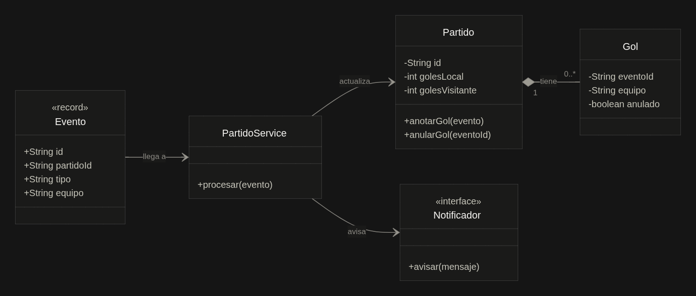
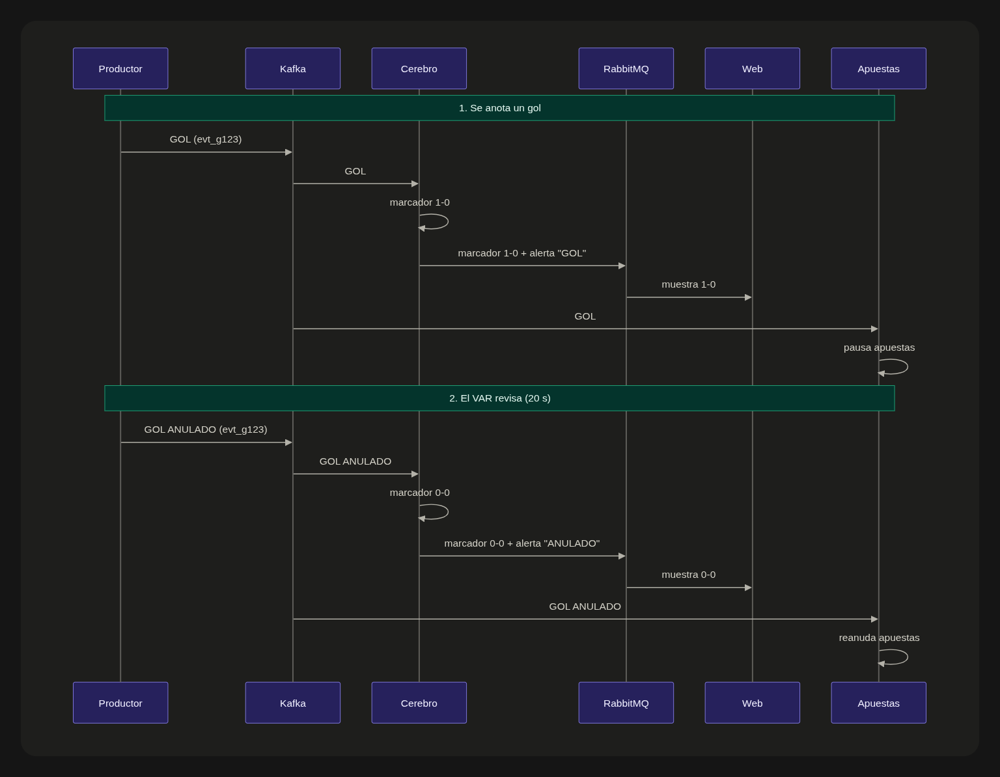

# VAR-Enabled

**VAR-Enabled** es una plataforma de **gestión de marcadores** deportivos en tiempo real para partidos de fútbol. Recibe los eventos de varios partidos a la vez (goles, faltas, revisiones del VAR), calcula el marcador oficial de cada uno y lo distribuye al instante a dashboards web, servicios de notificación, sistemas de apuestas y módulos de auditoría.

Su característica principal es la gestión de reversiones por VAR. Cuando el VAR anula un gol que ya se había registrado y notificado, la plataforma:

- **Corrige el marcador:** reconcilia el estado y vuelve, por ejemplo, de 1-0 a 0-0.
- **Avisa la corrección** a todos los sistemas que reciben el marcador.
- **Reanuda las apuestas** que se habían suspendido.
- **Deja trazabilidad** de la decisión en la base de datos de auditoría.

Para lograrlo, **VAR-Enabled** usa una arquitectura de microservicios orientada a eventos:

- **Apache Kafka** es el registro inmutable del partido, la única fuente de verdad.
- **RabbitMQ** reparte las actualizaciones, las alertas y los comandos.
- **PostgreSQL** guarda el historial para auditoría.

Todo está construido en Java 17 con Spring Boot y orquestado con Docker Compose.

## Requisitos de Funcionalidades
### Funcionales
 - **RF1** - Generar eventos al azar de varios partidos: gol, falta, revisión VAR, gol anulado y “sigue el juego”
- **RF2** - Registrar cada evento en Kafka, en orden, por partido
- **RF3** - Calcular el marcador correcto de cada partido
- **RF4** - Anular un gol específico cuando llegue “gol anulado” con su ID
- **RF5** - Rechazar la anulación de un gol que no existe
- **RF6** - Mostrar el marcador en vivo en una página web
- **RF7** - Enviar alertas de “¡GOL!” y “¡GOL ANULADO POR EL VAR!”
- **RF8** - Pausar las apuestas cuando hay gol o revisión del VAR
- **RF9** - Reanudar las apuestas cuando se anula el gol o sigue el juego
- **RF10** - Guardar todos los eventos y anulaciones en PostgreSQL

### No funcionales
- **RNF1** - Tiempo real: el marcador se actualiza en segundos
- **RNF2** - Orden: los eventos de un mismo partido nunca se desordenan (se usa match_id como clave en Kafka)
- **RNF3** - No perder eventos: Kafka guarda el historial de forma permanente
- **RNF4** - Desacople: cada servicio funciona por separado y se comunica solo por Kafka o RabbitMQ
- **RNF5** - Escalable: el worker de apuestas corre en varias copias que se reparten el trabajo
- **RNF6** - Recursos limitados: cada contenedor tiene un límite de CPU y RAM
- **RNF7** - Seguridad: los contenedores corren sin usuario administrador
- **RNF8** - Calidad: la lógica tiene pruebas con JUnit y Mockito
- **RNF9** - Fácil de levantar: todo arranca con un solo docker compose up

### Reglas de negocio
- **RN1.** El marcador nunca puede ser negativo.
- **RN2.** Solo se puede anular un gol que ya se registró.
- **RN3.** Un gol no se puede anular dos veces.
- **RN4.** Cada evento tiene un ID único.

### Tecnologias
#### Componente / Rol en la plataforma
- **Apache Kafka	Sistema de registro (log inmutable)** la única fuente de verdad del historial de cada partido
- **RabbitMQ** Sistema de acciones: reparte las actualizaciones, alertas y comandos
- **PostgreSQL** Persistencia relacional para auditoría e historial
- **Spring Boot (Java 17)**	Implementación de los microservicios con POO y SOLID
- **Docker Compose** Orquestación de la plataforma con límites de recursos

## Diagrama de Clases

## Diagrama de Flujo

# 